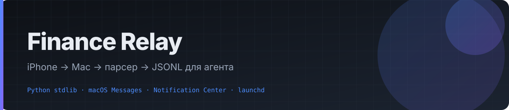
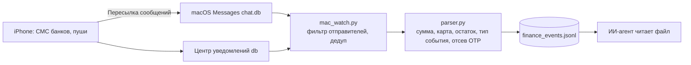

# Finance Relay: финансовый поток для ИИ-агента без доступа к банкам



   

**[Страница проекта](https://vladislav352.github.io/finance-relay/)**

> Агент видит ваши траты, доходы, остатки и долги, не имея ни одного банковского логина. Сторож на Mac читает СМС и уведомления банков, которые iPhone пересылает на Mac, вырезает коды и OTP, нормализует события в JSONL, а агент просто читает файл. Только чтение, всё локально.
>
> *Give your AI agent a read-only feed of your personal finances with zero bank credentials: a macOS watcher parses bank SMS/notifications forwarded from iPhone (Messages.app and Notification Center databases), strips OTPs, writes normalized JSONL events. Python stdlib, launchd.*

## Как это работает



Перехватить push чужих приложений на самом iPhone нельзя (ограничение iOS), поэтому точка перехвата — Mac, где и так живёт агент. Телефонное приложение и интернет-канал не нужны.

| База macOS | Что там | Путь |
|---|---|---|
| Messages.app | СМС с айфона (Пересылка сообщений), в т.ч. банки | `~/Library/Messages/chat.db` |
| Центр уведомлений | всплывающие уведомления приложений | `~/Library/Group Containers/group.com.apple.usernoted/db2/db` |

Обрабатываются только отправители из списка `BANK_SENDERS` (`mac_watch.py`) и только сообщения, где парсер видит финансовое событие. Личные чаты не трогаются.

## Событие

```json
{"event_id":"...","timestamp":"2026-09-28T...","source_type":"sms","bank":"sber",
 "event_type":"expense","amount":1250.5,"currency":"RUB","account_hint":"****1234",
 "merchant":null,"balance_after":83500.0,"debt_amount":null,"deadline":null,
 "raw_text":"...","confidence":0.6,"device_id":"mac-mini"}
```

`event_type`: expense | income | transfer | balance | debt | tax | fine | refund | unknown. Парсер (`parser.py`) на регулярных выражениях: суммы с пробелами и запятыми, валюта, последние 4 цифры карты, остаток, срок оплаты, определение банка, отсев рекламы.

## Безопасность

- Только чтение. Программа не логинится в банки и не делает переводов.
- Сообщения с кодом, OTP, паролем отбрасываются дважды: в парсере и в стороже.
- Номера карт только в виде `****1234`.
- Наружу ничего не уходит. Единственный ручной шаг: выдать Python «Полный доступ к диску» в настройках macOS, иначе базы Messages не читаются.

## Установка

1. Системные настройки → Конфиденциальность и безопасность → Полный доступ к диску → добавить интерпретатор Python, который будет запускать сторож.
2. Проверка вручную:

```bash
cd finance-relay/server
python3 mac_watch.py --once              # печатает найденные события, пишет data/finance_events.jsonl
python3 mac_watch.py --once --all-senders   # отладка без фильтра по банкам
```

3. Постоянная работа: поправить пути в `app.financerelay.watch.plist`, затем

```bash
cp app.financerelay.watch.plist ~/Library/LaunchAgents/
launchctl load ~/Library/LaunchAgents/app.financerelay.watch.plist
```

## Необязательный приёмник по сети

`main.py` + `parser.py` — FastAPI-сервер (`/finance-event`, `/ingest-raw`, `/events`) с Bearer-токеном, если захочется слать события с других устройств. Для схемы «iPhone + Mac» он не нужен.

## Автор

Владислав Арсентьев. Собрано с Claude Code.
